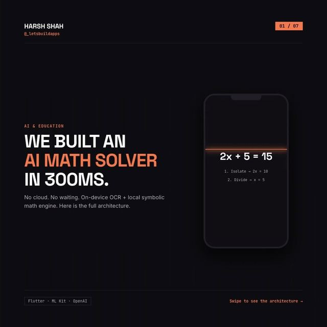

# Local-first math solving: solve on the device, ask the LLM only when needed

<p align="center"><a href="https://www.instagram.com/p/DcJMd8fDEKm/"></a></p>

> The original carousel on Instagram: [Day 1, @_letsbuildapps](https://www.instagram.com/p/DcJMd8fDEKm/)

The carousel's idea: a three-layer router. Try to solve the problem on the device first (free, instant, offline), and only call a cloud model for what the device can't solve.

| Layer | In this demo |
|---|---|
| 1. OCR | **Not included.** The carousel uses ML Kit to read a photo. Here you pass text in. |
| 2. Symbolic parser | [`lib/symbolic_parser.dart`](lib/symbolic_parser.dart): arithmetic, linear equations and quadratics, with steps |
| 3. LLM fallback | [`lib/math_router.dart`](lib/math_router.dart): `LlmExplainer` interface and the routing logic from the slide |

```bash
dart pub get
dart test    # 9 tests
```

## What it solves

| Input | Result |
|---|---|
| `2x + 5 = 15` | `x = 5`, steps: Isolate: 2x = 10, then Divide by 2: x = 5 (the carousel's example) |
| `3 + 4 * 2` | `11` |
| `3x - 4 = x + 10` | `x = 7` |
| `x^2 - 5x + 6 = 0` | `x = 2 or x = 3` |
| `prove that sqrt(2) is irrational` | unsolved, so the router asks the LLM |

The router is the `solve` function from the slide: try the local parser, return if solved, otherwise escalate.

```dart
final router = MathRouter(llm: MyLlm());
final result = await router.solve('2x + 5 = 15'); // solved locally, the LLM is never called
```

## What is NOT here

- **No OCR and no LaTeX.** Input is plain text like `2x + 5 = 15`. Reading it from a camera frame, and converting LaTeX, would come first in a real app.
- **No LLM.** `LlmExplainer` is an interface. Put your own backend behind it, and keep the API key on your server, not in the app.
- **Limited math.** One variable `x`, up to degree 2, real roots. Everything else is reported as unsolved on purpose, so it goes to the LLM instead of being guessed.
- **No timings, cost or accuracy figures.** The carousel quotes speed and cost numbers. This demo doesn't measure or claim any. The analytics hook only reports how long each call took on your machine.
