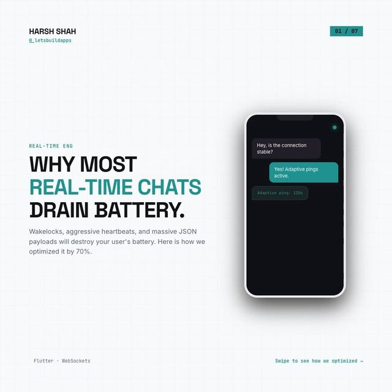

# Real-time chat without the battery drain: adaptive heartbeat and backoff

<p align="center"><a href="https://www.instagram.com/p/DcLuXtPDGB6/"></a></p>

> The original carousel on Instagram: [Day 2, @_letsbuildapps](https://www.instagram.com/p/DcLuXtPDGB6/)

A chat connection can drain the battery through connection management, not message rendering. Two of the carousel's ideas, as plain Dart you can test without a phone:

| From the carousel | In this demo |
|---|---|
| `AdaptiveSocketManager` (slide 5): stretch the ping interval in the background | [`lib/adaptive_socket_manager.dart`](lib/adaptive_socket_manager.dart) |
| Reconnect with exponential backoff and jitter, not an immediate retry loop | `ReconnectBackoff` in the same file |

```bash
dart pub get
dart test    # 10 tests (fake clock, so no waiting)
```

## Use it

```dart
final manager = AdaptiveSocketManager(send: () => socket.add('ping'))..start();

// Flutter: WidgetsBindingObserver.didChangeAppLifecycleState
manager.onAppStateChange(state == AppLifecycleState.paused ? AppState.background : AppState.foreground);

// On disconnect:
await Future.delayed(backoff.delayFor(attempt++)); // then reconnect
```

## Differences from the slide

- The slide imports Flutter's `AppLifecycleState`. This demo uses its own `AppState` enum so it runs as plain Dart.
- A state change only re-arms the timer if the manager is running. The slide's version would start pinging even if you had never started it.
- The slide's code uses **30 s foreground / 120 s background**. Slide 4's text says 20 s foreground. Both values are constructor parameters.

## What is NOT here

- **No WebSocket.** `send` is whatever sends a ping on your socket.
- **No Protocol Buffers.** The carousel also swaps JSON for Protocol Buffers. That is a separate change in your message layer.
- **The 30-second inactivity switch to background state** described on slide 4 is not implemented. Here the app calls `onAppStateChange`.
- **Backoff numbers are illustrative.** The carousel's example is roughly 1.5 s, 3 s, 7 s, 15 s. This demo gives 1.5 s, 3 s, 6 s, 12 s, then 15 s, with 20% jitter.
- **No battery, payload or delivery figures.** The carousel quotes percentages. This demo doesn't measure or claim any. Test on real devices.
