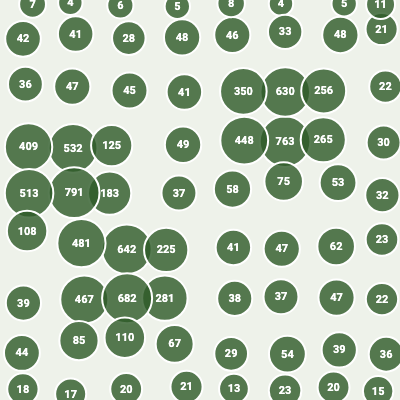

# Map markers: cluster in a background isolate, paint on one canvas

> From the carousel on Instagram: [Day 3, @_letsbuildapps](https://www.instagram.com/p/DcNmeaamXWp/)

Drawing thousands of marker widgets is slow. The carousel's approach has three parts, and this demo has code for each:

| Carousel slide | In this demo |
|---|---|
| Cluster with a static grid, off the main thread, using `compute` | [`lib/cluster_engine.dart`](lib/cluster_engine.dart): `MapClusterEngine.computeClusters` |
| Only cluster what is on screen, plus a 10% padding margin | `BoundingBox.expand(0.10)`, applied inside the algorithm |
| Draw circles and counts straight onto a canvas in one paint call, with no widget per marker | [`lib/cluster_painter.dart`](lib/cluster_painter.dart): `ClusterPainter` |

```bash
flutter pub get
flutter test    # 9 tests (+1 screenshot test, skipped unless SCREENSHOT=1)
```

<p align="center"></p>

*10,000 synthetic markers at zoom 6 became 72 circles in this seeded run. Rendered by [`test/screenshot_test.dart`](test/screenshot_test.dart), which you can re-run with `SCREENSHOT=1 flutter test test/screenshot_test.dart`. This is not a map and not a performance measurement.*

## How it works

- `cellSizeDegrees(zoom)` gives a grid cell size that depends only on the zoom level ("static grid spacing"). Every marker lands in one cell, and each occupied cell becomes one `ClusterNode` at the average position of its markers.
- Markers outside the viewport box (grown by 10%) are skipped entirely.
- `ClusterPainter` loops over the clusters once and draws a circle plus a count. A cluster of 1 shows no number.

```dart
final clusters = await MapClusterEngine.computeClusters(points: points, zoom: zoom, bbox: visibleBox);
// then: CustomPaint(painter: ClusterPainter(clusters: clusters, viewport: visibleBox))
```

Recompute when the zoom changes (the carousel does it then), and when the visible box moves far enough to matter.

## What is NOT here

- **No SQLite step.** The carousel's pipeline starts with loading markers from SQLite. Here you pass in a list.
- **No Kd-tree.** The post's caption mentions Kd-tree indexing, but the slides describe grid clustering, and that is what this demo implements.
- **No map or projection.** The painter maps latitude and longitude to pixels with a simple linear formula, which is only fine for a demo. In a real app, use your map SDK's projection and put this painter in its overlay.
- **No frame-rate or timing claims.** Nothing here was measured on a device. Profile your own app.
- Cluster quality is basic: a marker near a cell edge can be separated from a close neighbour in the next cell.
