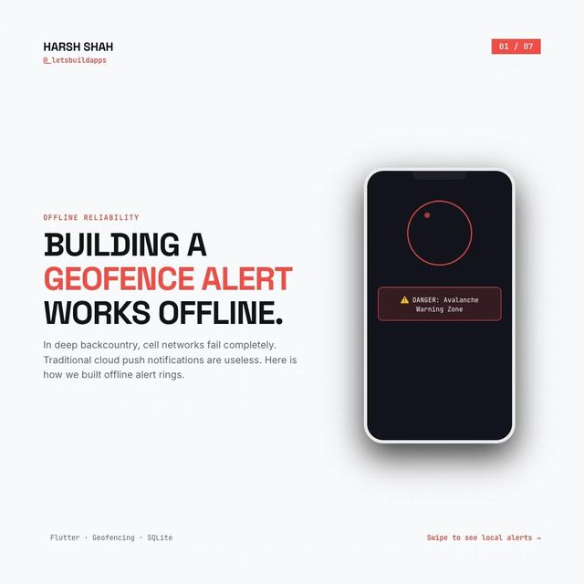

# Offline geofence alerts: ray casting on the device

<p align="center"><a href="https://www.instagram.com/p/DcVYUIcjLbC/"></a></p>

> The original carousel on Instagram: [Day 6, @_letsbuildapps](https://www.instagram.com/p/DcVYUIcjLbC/)

In the backcountry there is no cell signal, so cloud push can't warn a hiker. The carousel's approach: keep hazard zones on the device and check the GPS position against them locally.

| Piece from the carousel | File |
|---|---|
| Ray-casting `isPointInPolygon` (slide 5) | [`lib/geofence.dart`](lib/geofence.dart) |
| Hazard zones stored locally as GeoJSON | `zonesFromGeoJson` in the same file |
| Location stream, then a check, then an alert | `GeofenceMonitor`: fires **entered** and **exited** once per crossing |

```bash
dart pub get
dart test    # 7 tests
```

## How it works

```dart
final zones = zonesFromGeoJson(await myLocalFile.readAsString()); // loaded while you had signal
final monitor = GeofenceMonitor(zones);

locationStream.listen((p) {
  for (final e in monitor.update(LatLng(p.latitude, p.longitude))) {
    if (e.type == GeofenceEventType.entered) showLocalNotification('DANGER: ${e.zone.name}');
  }
});
```

`isPointInPolygon` counts how many polygon edges a ray from the point crosses. An odd count means inside. It works on concave shapes: one test checks the notch of an L-shaped zone.

## What is NOT here

- **No SQLite, GPS plugin or notifications.** The carousel stores zones in SQLite and fires native local notifications. Here zones come from a GeoJSON string and you wire the location stream and the notification yourself. None of that needs a network.
- **No background execution.** Keeping location updates alive in the background is platform work (permissions, foreground services).
- **Simple polygons only.** Outer ring of `Polygon` features. No holes, no `MultiPolygon`, no circles.
- **Edge cases:** a point exactly on an edge may count as inside or outside. GPS noise near a border can cause repeated enter/exit events. Add a margin or a short delay if that matters for you.
- **No latency or reliability numbers.** The carousel quotes a millisecond figure and "100% offline reliability". This demo doesn't claim them. Measure on your own devices.
