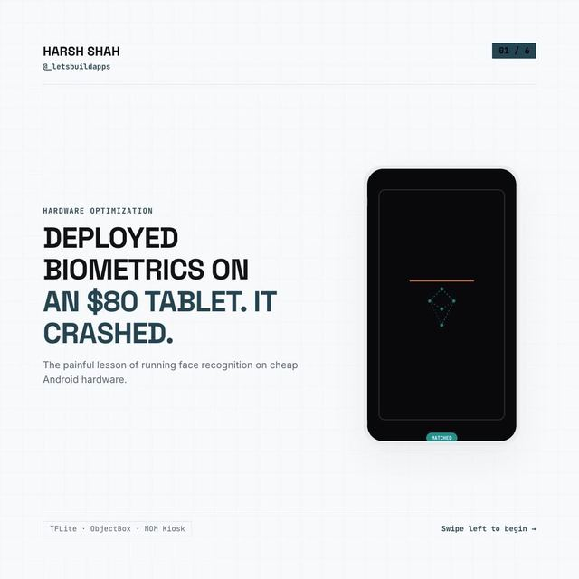

# Face matching on weak hardware: reuse buffers, keep work off the UI thread

<p align="center"><a href="https://www.instagram.com/p/DdNtRBhjLuq/"></a></p>

> The original posts on Instagram by @_letsbuildapps: [Day 7 reel](https://www.instagram.com/reel/DcXolElmbMu/) and [Day 28 carousel](https://www.instagram.com/p/DdNtRBhjLuq/)

Two lessons from running face recognition on a cheap tablet, as plain Dart you can test without a camera or a model.

| Carousel slide | In this demo |
|---|---|
| "Reuse image buffers to prevent allocations": `Uint8List(width * height * 4)` | [`lib/frame_buffer_pool.dart`](lib/frame_buffer_pool.dart): buffers created once and handed out again |
| "Offload ML to a background Isolate": `Isolate.run(...)` | `matchOffMainThread` in [`lib/face_matcher.dart`](lib/face_matcher.dart) |
| Pipeline: camera frame, then isolate embedding, then cosine match | `fakeEmbedding` plus `FaceMatcher` and cosine similarity |

```bash
dart pub get
dart test    # 13 tests
```

## How the pieces fit

```dart
final pool = FrameBufferPool(width: 640, height: 480);          // allocated once
final frame = pool.tryAcquire();                                // null = drop this camera frame
if (frame != null) {
  copyCameraImageInto(frame);                                   // your camera plugin code
  final result = await matcher.matchOffMainThread(embed(frame)); // heavy work off the UI thread
  pool.release(frame);
}
```

A test runs 1,000 frames through a 3-buffer pool and checks that nothing beyond the first 3 buffers is ever created.

## What is NOT here

- **No TFLite, no camera, no ObjectBox.** `fakeEmbedding` just averages pixels so the pipeline can run. It is **not** a face model and will not recognize faces. Real embeddings come from a neural network.
- **No accuracy or speed figures.** The posts quote match rates and "under 40 ms". Nothing here measures or claims any. Test on your own hardware.
- **Isolate cost.** `Isolate.run` copies its inputs, as in the slide. With a large template gallery, a long-lived worker isolate that holds the templates is better.
- **No thermal-throttling handling.** The carousel mentions it as a problem; there is no code for it here.
- **The 0.8 threshold is a placeholder.** Pick yours from real data.
