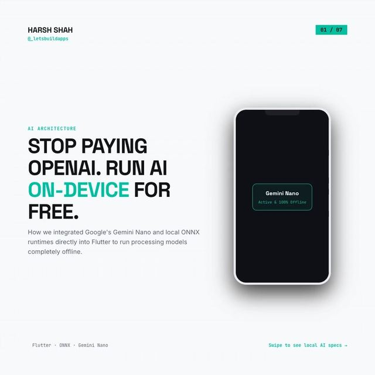

# Local-first AI: small tasks on the device, big reasoning in the cloud

<p align="center"><a href="https://www.instagram.com/p/DcxKtWymW6b/"></a></p>

> The original posts on Instagram by @_letsbuildapps: [Day 17 carousel](https://www.instagram.com/p/DcxKtWymW6b/)

The carousel's idea: don't send every request to a paid cloud model. Handle simple tasks (input validation, spelling, categorization, translation) with a small model on the device, and send only complex reasoning to the cloud.

| From the carousel | In this demo |
|---|---|
| Simple tasks run locally | `AiTask.isSimple` and the routing in [`lib/local_first_ai.dart`](lib/local_first_ai.dart) |
| Local models pre-process input before complex requests go to the cloud ("intelligent prompt filtering") | `LocalFirstAi.run` tidies the input with the local model before a `reason` task goes to the cloud |
| Offline: cloud features freeze | Offline, simple tasks still work, and complex ones fail with `NeedsNetworkException` |

```bash
dart pub get
dart test    # 8 tests
```

## Use it

```dart
final ai = LocalFirstAi(local: MyOnDeviceModel(), cloud: MyBackendModel(), connectivity: MyConnectivity());

final category = await ai.run(AiTask.categorize, 'pizza and cola'); // answered on the device
final answer = await ai.run(AiTask.reason, 'why did my order fail?'); // goes to the cloud
```

`LocalModel` and `CloudModel` are interfaces. A local model returns `null` when it can't answer, and the router then falls back to the cloud. A local model that throws is treated the same way, so a broken model can't break the feature.

## What is NOT here

- **No model.** The slide's `GoogleAICore` / on-device session code is not included, because those SDKs and their device support change quickly. Put whichever runtime you use behind `LocalModel`.
- **No quantization, memory or latency work.** The carousel talks about 4-bit models and background isolates. That is model-runtime work, not routing logic.
- **No cost or speed figures.** The carousel quotes prices, milliseconds and percentages of requests kept local. This demo only counts local versus cloud answers in `localAnswers` and `cloudAnswers`, so you can measure your own split.
- **The simple/complex split is a fixed list.** Real apps may want a smarter decision, such as input length or the local model's own confidence.
- Keep cloud API keys on your server, not in the app.
