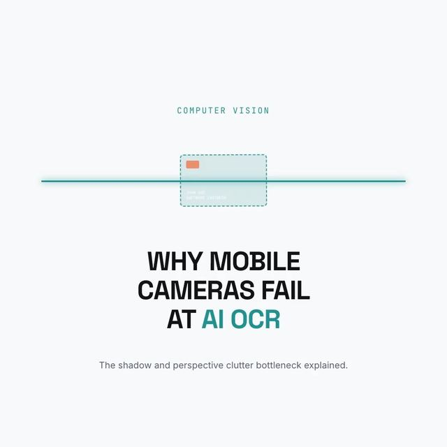

# Before OCR: flatten the skewed card, then parse the text

<p align="center"><a href="https://www.instagram.com/reel/DdF-zuvjGck/"></a></p>

> The original posts on Instagram by @_letsbuildapps: [Day 25 reel](https://www.instagram.com/reel/DdF-zuvjGck/) and [Day 46 reel](https://www.instagram.com/reel/Dd8Dl5_jBjI/)

OCR works much better on a flat, evenly lit page than on a tilted photo with a cluttered background. Two pieces from the posts, as plain Dart you can test without a camera or an OCR engine.

| From the posts | In this demo |
|---|---|
| Day 25: warp a tilted card to a flat rectangle (perspective correction) before extraction | [`lib/perspective.dart`](lib/perspective.dart): `warpQuadToRect` |
| Day 46, step 3: turn OCR text into structured data with regular expressions | [`lib/receipt_parser.dart`](lib/receipt_parser.dart): `parseReceipt` |
| Day 46, step 1: adaptive thresholding | Not repeated here. See [`day_27_binarization`](../day_27_binarization) |

```bash
dart pub get
dart test    # 11 tests
```

## Perspective correction

You give `warpQuadToRect` the four corners of the card in the photo (top-left, top-right, bottom-right, bottom-left) and the size you want. It solves a homography (the projective transform between the two quadrilaterals) and samples the photo with bilinear interpolation to produce a flat, upright image.

```dart
final flat = warpQuadToRect(photo, [Point(30, 20), Point(170, 40), Point(160, 120), Point(20, 100)], 640, 400);
```

The tests check that the output corners map onto the quad's corners, that an upright quad is just a crop, and that a skewed painted card comes out as an even rectangle.

## Receipt text

```dart
final r = parseReceipt('Merchant: Blue Bottle\nDate: 1 Oct 2026\nTotal: \$42.50');
// r.merchant == 'Blue Bottle', r.date == 2026-10-01, r.total == 42.50
```

It ignores "Subtotal", takes the last "Total", and accepts dates like `1 Oct 2026` and `2026-10-01`. If there's no "Merchant:" label, it falls back to the first line of text. That fallback is a guess I added. Real receipts vary a lot, so expect to adapt the patterns to yours.

## What is NOT here

- **No card detection.** Day 25 mentions detecting the card's edges (the post lists OpenCV). Here **you** supply the four corners. Finding them needs an edge or contour detector, which this demo doesn't include.
- **No OCR engine.** `parseReceipt` takes text as input. Getting the text (for example with ML Kit) is a separate step.
- **Grayscale only.** `GrayImage` is a single 8-bit channel. Convert from RGB first.
- **No accuracy figures.** Day 25 quotes accuracy before and after warping. Nothing here measures or claims any, since it depends on your camera, cards and OCR engine.
- It is pure Dart and not tuned for speed. For large photos on a phone, use a native or GPU path.
