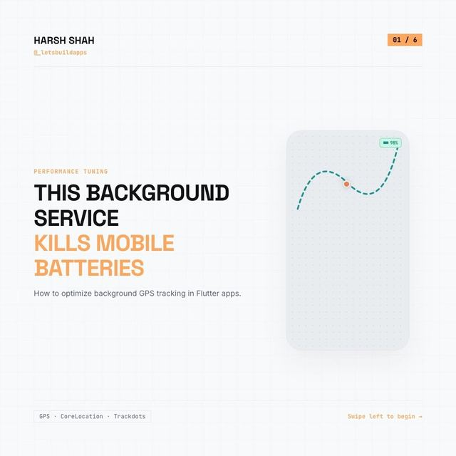

# Background GPS: poll smarter, upload in batches

<p align="center"><a href="https://www.instagram.com/p/DdIqc9pDMHs/"></a></p>

> The original carousel on Instagram: [Day 26, @_letsbuildapps](https://www.instagram.com/p/DdIqc9pDMHs/)

Two of the three tips from the carousel, as plain Dart you can test without a phone.

| Tip | File |
|---|---|
| 1. Dynamic distance filters: change how often you ask based on speed | [`lib/polling_policy.dart`](lib/polling_policy.dart) |
| 2. Batch uploads: store locally, upload in one go every 2 minutes | [`lib/location_batcher.dart`](lib/location_batcher.dart) |

```bash
dart pub get
dart test    # 7 tests
```

## How the pieces fit

- Ask your location plugin for updates with `PollingPolicy.forSpeed(currentSpeed)`'s `distanceFilterMeters` and `pollInterval`, and re-evaluate when the speed class changes.
- For every location you get, call `batcher.record(point)`. It stores the point and uploads the whole batch once the flush interval has passed. If the upload fails, the points stay stored and the next flush retries.

## Things to know

- **The speed tiers and their numbers are illustrative.** The carousel gives the idea, not these values.
- **The store is in memory.** The carousel mentions Hive. Implement `PointStore` on Hive or SQLite so points survive the app being killed.
- A flush only happens when `record` or `flush` is called. In a real app, call `flush()` from your own timer or background task too.
- **Not covered:** tip 3 (deferred location updates on low-power native hardware) is a platform feature with its own native APIs and restrictions, not something this Dart code can show. The accelerometer wake-up idea from slide 3 isn't implemented either.
- **No battery claims.** Nothing here measures battery use. Measure on your own devices.
