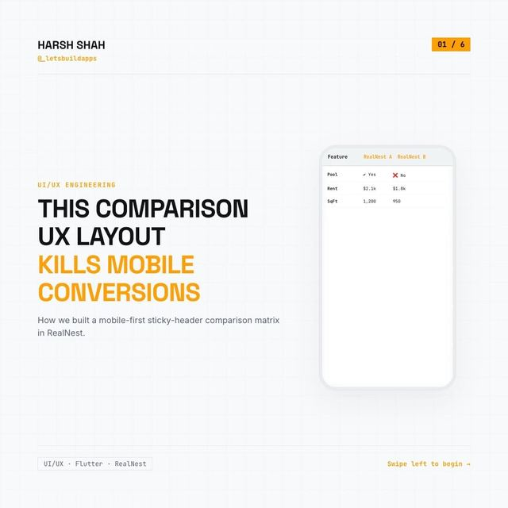
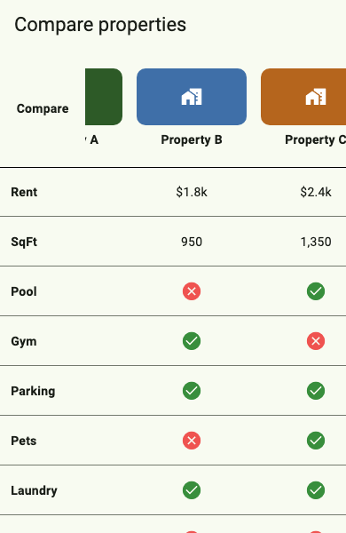

# Mobile comparison table: pinned header, fixed labels, synced scrolling

<p align="center"><a href="https://www.instagram.com/p/DdSv86lDKlU/"></a></p>

> The original carousel on Instagram: [Day 30, @_letsbuildapps](https://www.instagram.com/p/DdSv86lDKlU/)

A wide comparison table is hard on a phone: people scroll sideways and lose track of which column is which. The carousel's layout fixes that, and this is a small runnable version of it.

<p align="center"></p>

*Rendered from this demo's fake data by [`test/screenshot_test.dart`](test/screenshot_test.dart). Regenerate with `SCREENSHOT=1 flutter test test/screenshot_test.dart`.*

| From the carousel | In this demo |
|---|---|
| Header with the properties pinned at the top while rows scroll | `SliverPersistentHeader(pinned: true)` in [`lib/comparison_matrix.dart`](lib/comparison_matrix.dart) |
| Label column stays on screen | A fixed `Column` to the left of the scrolling values |
| Sync scroll controllers so header and rows move together (slide 4) | [`lib/linked_scroll.dart`](lib/linked_scroll.dart) |

## Run it

This folder has no platform folders. Generate them once, then run:

```bash
flutter create .
flutter pub get
flutter test    # 6 tests (+1 screenshot test, skipped unless SCREENSHOT=1)
flutter run
```

## Syncing the two scrollers

The slide's code moves controller B when A scrolls. `LinkedScrollControllers` links both directions, so dragging the header or the rows moves the other. A `_syncing` flag stops the two from triggering each other in a loop, and the target offset is clamped to the other controller's range.

## What is NOT here

- **No real photos.** The picture area in the header is a coloured box. Put your property image there.
- **No booking button.** The carousel mentions keeping calls to action visible. Add yours to the pinned header.
- **Not lazy.** All rows are built up front (`SliverToBoxAdapter`), which is fine for a comparison table of a few dozen rows. For hundreds of rows you'd want a lazy design.
- **Fixed sizes.** Row height and column width are constants. Text that wraps differently per column would need a taller row.
- **No conversion figures.** The carousel quotes click, dwell and bounce numbers. They come from a live product, and nothing here measures or claims them.
