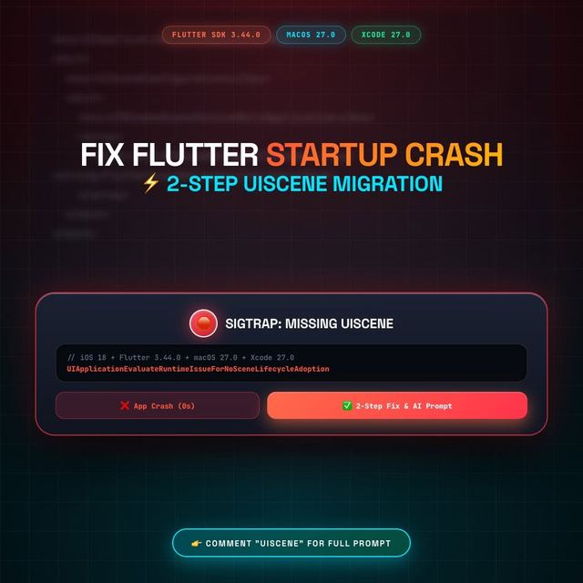

# Flutter iOS: UIScene lifecycle migration

> The original reel on Instagram: [Day 49, @_letsbuildapps](https://www.instagram.com/reel/DeDx7-KDJwP/)

**Symptom:** the app crashes at launch on iOS with `SIGTRAP`, and the log mentions
`UIApplicationEvaluateRuntimeIssueForNoSceneLifecycleAdoption`. Apple expects apps to adopt the UIScene lifecycle.

The fix has two edits in `ios/Runner/`.

## Step 1: declare the scene manifest in `Info.plist`

Add the block from [`Info.plist.snippet.xml`](Info.plist.snippet.xml) inside the top-level `<dict>`.
It points the app's window scene at `FlutterSceneDelegate`.

## Step 2: adopt the implicit engine in `AppDelegate.swift`

Compare [`AppDelegate.old.swift`](AppDelegate.old.swift) (before) with [`AppDelegate.swift`](AppDelegate.swift) (after).
Plugin registration moves into `didInitializeImplicitFlutterEngine`, and `AppDelegate` conforms to `FlutterImplicitEngineDelegate`.

## Watch out for

- **Duplicate Firebase init.** If you initialise Firebase from Dart (`DefaultFirebaseOptions`), do not also call `FirebaseApp.configure()` in the AppDelegate.
- **Other native code** that assumed `window` on the AppDelegate may need to move to the scene delegate.

## Honest notes

- Written from the steps shown in the Reel and Flutter's UIScene migration guidance. I have **not** verified it against every Flutter or Xcode version. Check the official Flutter docs for your SDK before shipping.
- The Reel also suggests keeping `import Flutter` before `import UIKit`. That matches the default Flutter template, but I have not confirmed that the order matters.

## AI prompt

[`AI_PROMPT.md`](AI_PROMPT.md) is a copy-paste prompt you can give a coding agent to apply this migration to your project.
