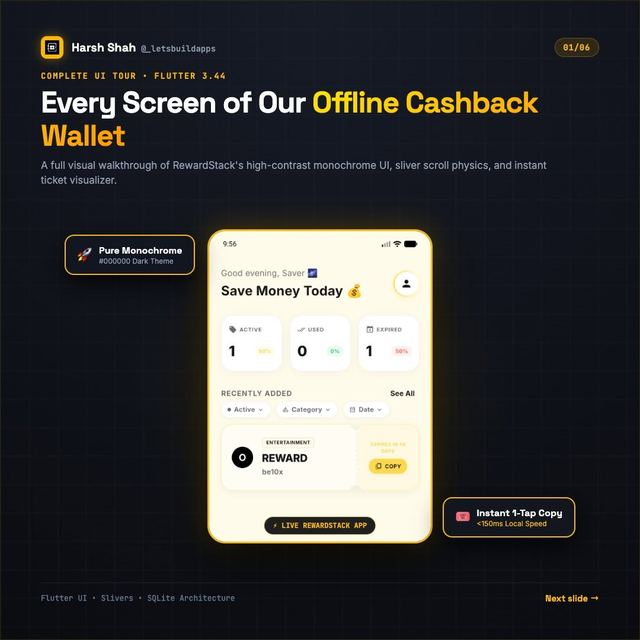
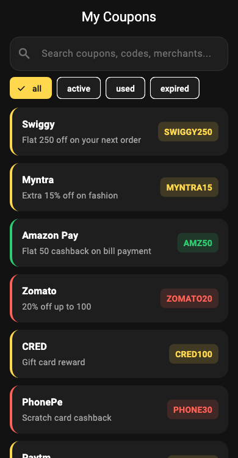

# Pinned sliver layout: app bar, search header, list

<p align="center"><a href="https://www.instagram.com/p/DeOFKPAGXB2/"></a></p>

> The original carousel on Instagram: [Day 54, @_letsbuildapps](https://www.instagram.com/p/DeOFKPAGXB2/)

A small runnable Flutter example of the list-screen structure from the carousel:

1. `SliverAppBar(pinned: true)` for the title.
2. `SliverPersistentHeader(pinned: true)` holding a search field and status chips. It has a fixed height, so `minExtent == maxExtent`.
3. `SliverList` (or `SliverFillRemaining` for the empty state) for the content.

Because the first two slivers are pinned, search and filters stay on screen while the list scrolls under them.

The colors live in [`lib/theme.dart`](lib/theme.dart): one brand yellow on dark surfaces, with coral for expired and green for used.
All data is fake.

<p align="center"></p>

*Rendered from this demo's fake data by [`test/screenshot_test.dart`](test/screenshot_test.dart). Regenerate with `SCREENSHOT=1 flutter test test/screenshot_test.dart`.*

## Run it

This folder has no platform folders. Generate them once, then run:

```bash
flutter create .
flutter pub get
flutter test
flutter run
```

## Notes

- The header here is **pinned, not collapsing**. If you want a collapsing header, use `SliverAppBar` with `expandedHeight` and `flexibleSpace`, or a delegate with different `minExtent` and `maxExtent`.
- This is a simplified example, not code copied from a production app.
